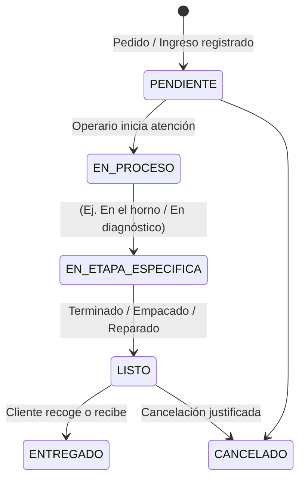

# Order Status Tracker Skill

Esta habilidad guía la arquitectura y construcción del motor universal de seguimiento de pedidos, citas y servicios para la plataforma.

## 1. El Ciclo de Vida Universal del Estado

Todo servicio o pedido sigue un autómata de estados finitos (Finite State Machine - FSM):

## 2. Componentes Clave

1. **State Dispatcher (Backend):**
   - Recibe la acción del personal: `PATCH /api/orders/{id}/status`.
   - Valida la transición permitida (evita pasar de "Pendiente" a "Entregado" sin pasar por "Listo").
   - Dispara dos eventos simultáneos:
     - Evento WebSocket / SSE a la pantalla de seguimiento web del cliente.
     - Encolado de mensaje en el servicio de WhatsApp para avisar al móvil del usuario.

2. **Panel de Cocina / Taller (KDS - Kitchen Display System / Shop Board):**
   - Diseñado con tarjetas grandes (Kanban touch-friendly).
   - Un botón gigante con el siguiente paso lógico.
   - Indicadores de tiempo transcurrido (cambio de color si supera el tiempo objetivo: verde -> amarillo -> rojo).

3. **Página de Seguimiento del Cliente (Live Tracking PWA):**
   - Sin autenticación requerida para el cliente: acceso seguro mediante token UUID único (`/track/:token`).
   - Barra de progreso animada con estados e ilustraciones claras.
   - Botón directo para "Contactar por WhatsApp" o "Llamar al local" en caso de dudas.
